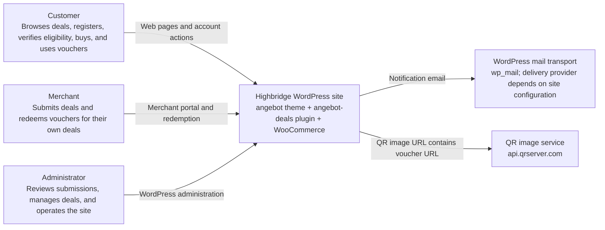
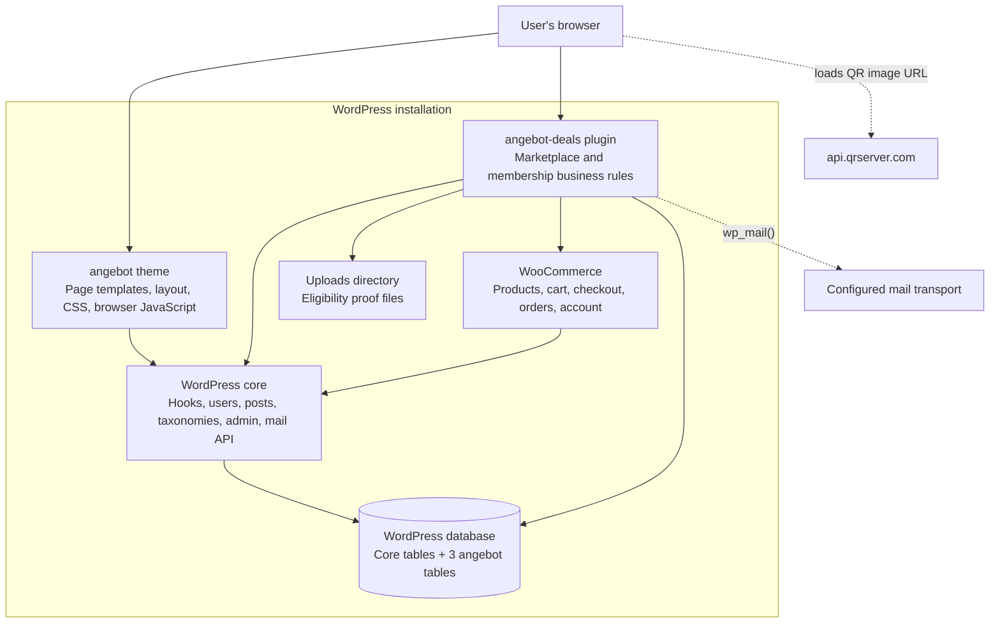
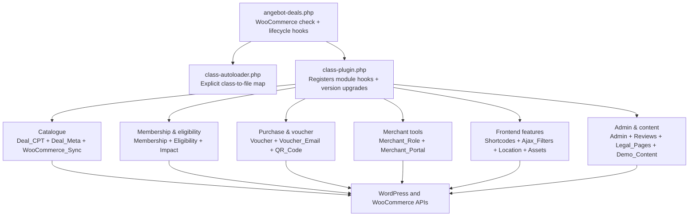
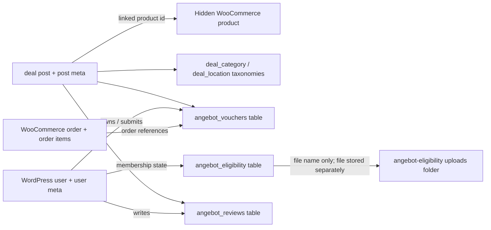
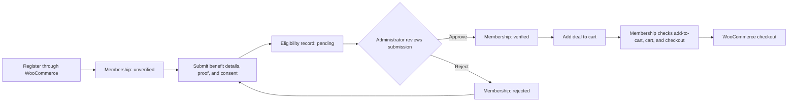
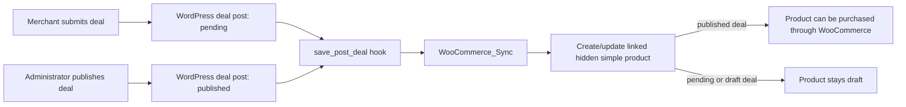
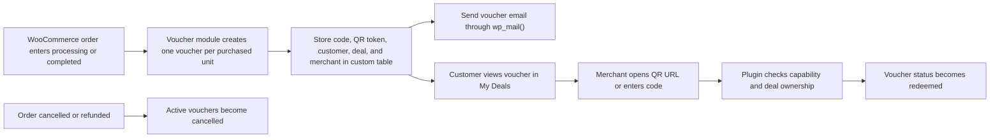
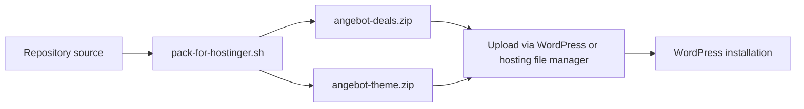

# Highbridge — Software Architecture

This document describes the implementation in the repository's `main` branch. It uses small context, container, and component views, followed by short process diagrams. The diagrams describe the code; they do not claim that the website is currently deployed or that every flow has been tested in production.

## 1. System purpose and scope

Highbridge is a local-deals marketplace implemented as a WordPress site. WooCommerce handles cart, checkout, orders, and products. The `angebot-deals` plugin provides deal listings, membership eligibility, merchant tools, vouchers, and reviews. The `angebot` theme renders the public pages.

The code and documentation currently disagree about the intended market. Eligibility text and the legal templates target UK benefit recipients, while the location seeder still creates German cities and defaults to Berlin. See [Known inconsistencies](#8-known-inconsistencies-and-follow-up) before presenting this as a finished UK marketplace.

## 2. System context (C4 Level 1)



The WordPress site is the system boundary. There is no separate application backend in the repository. WordPress and WooCommerce provide the runtime, user accounts, content, commerce APIs, and persistence used by the custom code.

## 3. Containers (C4 Level 2)



The plugin does not replace WooCommerce checkout. A deal is stored as a WordPress `deal` post, while a linked, hidden WooCommerce simple product is used for purchase. The theme and plugin both run inside the same WordPress request and use WordPress hooks and APIs.

## 4. Plugin components (C4 Level 3)

The plugin bootstrap checks for WooCommerce, registers the explicit class autoloader, and initializes the modules from `class-plugin.php`. The modules register callbacks on WordPress and WooCommerce hooks; there is no separate router or dependency-injection container.



| Area | Main classes | Responsibility |
|---|---|---|
| Catalogue | `Deal_CPT`, `Deal_Meta`, `WooCommerce_Sync` | Register deals and taxonomies, store deal metadata, and mirror published deals to hidden WooCommerce products. |
| Membership | `Membership`, `Eligibility`, `Impact` | Extend WooCommerce registration/account pages, collect and review eligibility submissions, gate purchases, and calculate impact totals. |
| Purchase and vouchers | `Voucher`, `Voucher_Email`, `QR_Code` | Create voucher rows from WooCommerce order status events, send voucher details, and resolve QR redemption URLs. |
| Merchant tools | `Merchant_Role`, `Merchant_Portal` | Limit merchants to their own deals and vouchers; support deal submission and voucher redemption. |
| Frontend | `Shortcodes`, `Ajax_Filters`, `Location`, `Assets` | Render deal grids and filters, persist location selection, and enqueue plugin assets. |
| Administration and content | `Admin`, `Reviews`, `Legal_Pages`, `Demo_Content` | Provide settings, review moderation, generated legal-page templates, and sample deals. |

## 5. Data ownership



The plugin creates three custom tables: `{prefix}angebot_vouchers`, `{prefix}angebot_eligibility`, and `{prefix}angebot_reviews`. The database prefix is configured by WordPress and is not guaranteed to be `wp_`. Deal descriptions and ownership use WordPress posts and post metadata; cart and order records belong to WooCommerce.

## 6. Main processes

### 6.1 Membership verification and purchase gate



The purchase check is attached at multiple WooCommerce stages so an unverified account cannot complete a purchase by bypassing the initial add-to-cart check. Eligibility proof is stored under the uploads directory and the handler checks the current user or the review capability before serving a file. These implementation controls do not by themselves establish legal compliance or safe server/back-up configuration.

### 6.2 Deal publishing and product synchronization



Merchant submissions set price and quantity metadata as part of the initial post insert. The sync listener then mirrors the deal's status, price, stock, text, and image to its WooCommerce product.

### 6.3 Order to voucher to redemption



Voucher generation is triggered for WooCommerce `processing` and `completed` order statuses, and cancellation/refund events cancel active vouchers. QR images are hosted by `api.qrserver.com`; voucher tokens are included in the URL sent to that service. Do not treat the QR service as a private or local component.

## 7. Packaging and deployment

The repository includes `pack-for-hostinger.sh` to build plugin and theme ZIP files. Uploading these packages to a WordPress site is a separate release step; the repository itself does not deploy to Hostinger. After installing routing changes, rewrite rules may need to be refreshed. Cache invalidation depends on the cache plugin configured on the target host.



## 8. Known inconsistencies and follow-up

These are observed mismatches between repository documentation, packaging, and source. Resolve them before describing the project as a finished UK deployment:

1. **Market and locations:** eligibility copy lists UK benefits, but `class-location.php` seeds German cities and sets Berlin as the default. The README's claims that London is the default and German locations are migrated to UK cities are not implemented in the inspected code.
2. **Folder naming:** the source directories in Git retain download suffixes (`angebot-deals (3)` and `angebot-theme (5)`). The packaging script now points to these actual directories, but renaming them to clean paths would make the repository easier to navigate; update the script and documentation with any rename.
3. **Email delivery:** the application calls `wp_mail()`. Actual delivery depends on the WordPress host or an SMTP/mail plugin; the code does not configure an SMTP provider itself.
4. **Production readiness:** the repository contains no automated test suite or deployment workflow. Documentation describes implementation behavior, not proof of live-site behavior. Eligibility handling also needs an operational/legal review before real sensitive documents are collected.

## 9. Source map

```text
plugin/angebot-deals (3)/angebot-deals/
├── angebot-deals.php          # Plugin entry point and lifecycle hooks
├── includes/                   # Business modules and WordPress hook handlers
├── admin/views/                # WordPress admin templates
├── templates/                  # Public and account templates
└── public/                     # Plugin CSS and JavaScript

theme/angebot-theme (5)/angebot/
├── functions.php               # Theme setup and asset loading
├── *.php                       # WordPress page templates
└── assets/                     # Theme CSS, JavaScript, and images
```

Keep this document aligned with the source tree, WordPress hooks, and release packaging when those change.
